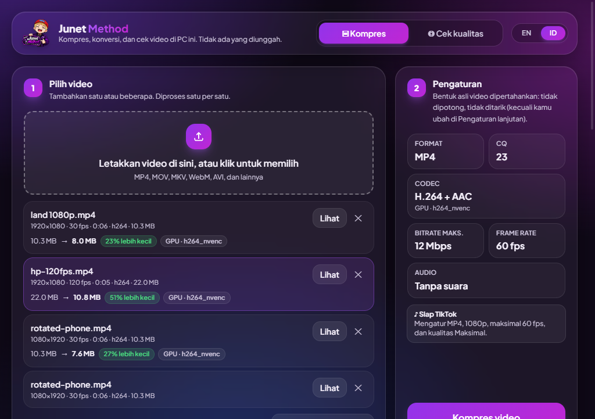
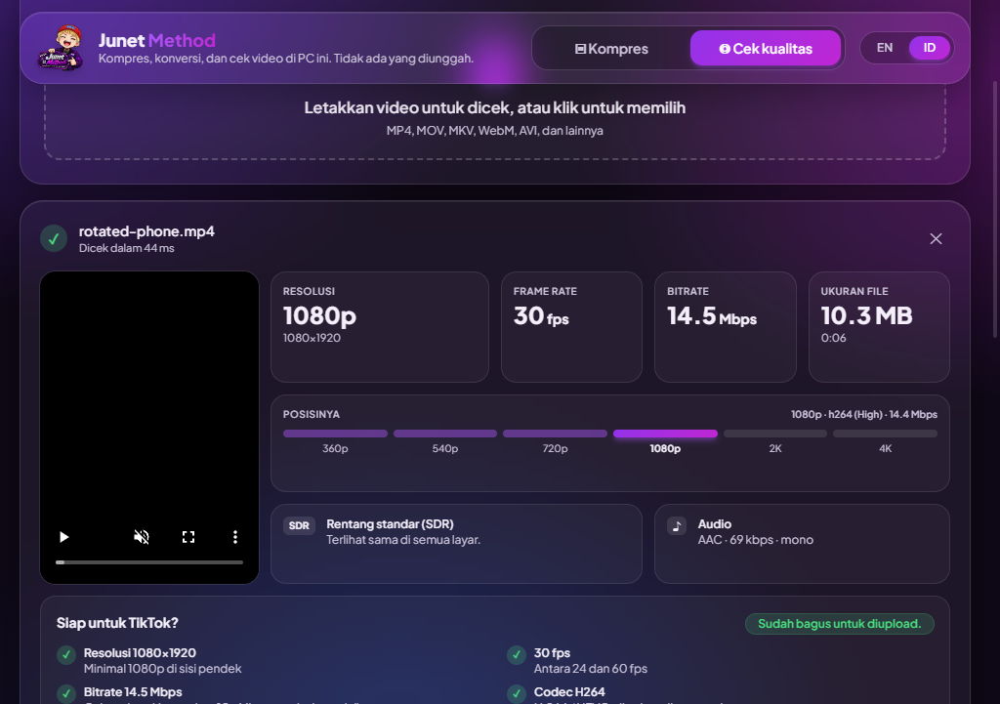

# Junet Method

**Kompres, konversi, dan cek kualitas video langsung di PC Windows kamu.**
Video tidak pernah diunggah ke mana pun. Semuanya diproses di komputer kamu sendiri, dan bisa memakai kartu grafis supaya jauh lebih cepat.

[**⬇ Unduh versi terbaru**](https://github.com/aditmat27/junet-method-releases/releases/latest) · [English summary](#english)



---

## Daftar isi

- [Unduh](#unduh)
- [Memasang](#memasang)
- [Cara pakai](#cara-pakai)
- [Fitur](#fitur)
- [Pembaruan (update)](#pembaruan-update)
- [Kebutuhan sistem](#kebutuhan-sistem)
- [Tips untuk TikTok](#tips-untuk-tiktok)
- [Masalah umum](#masalah-umum)
- [Melaporkan masalah](#melaporkan-masalah)
- [Privasi](#privasi)
- [Komponen pihak ketiga](#komponen-pihak-ketiga)

---

## Unduh

Buka [halaman rilis terbaru](https://github.com/aditmat27/junet-method-releases/releases/latest), lalu pilih salah satu di bagian **Assets**:

| File | Untuk siapa |
| --- | --- |
| `Junet-Method-Setup-x.y.z.exe` | **Disarankan.** Dipasang di PC, ada shortcut di Start menu dan desktop, dan **update otomatis**. |
| `Junet-Method-Portable-x.y.z.exe` | Tanpa instal. Cocok untuk flashdisk atau PC yang tidak boleh diinstal program. Update cukup dua klik. |

File `latest.yml` dan `.blockmap` dipakai aplikasi untuk update. Kamu tidak perlu mengunduhnya.

## Memasang

### Versi installer

1. Jalankan `Junet-Method-Setup-x.y.z.exe`.
2. Kalau muncul **"Windows protected your PC"**, klik **More info** lalu **Run anyway**.
   Peringatan ini muncul karena aplikasinya belum ditandatangani dengan sertifikat berbayar, bukan karena berbahaya.
3. Ikuti langkah installer. Kamu bisa memilih folder pemasangan.

Untuk menghapus: **Settings → Apps → Junet Method → Uninstall**.

### Versi portable

1. Taruh `Junet-Method-Portable-x.y.z.exe` di folder mana saja, misalnya di flashdisk.
2. Klik dua kali untuk menjalankan. Membukanya butuh beberapa detik, karena aplikasinya diekstrak dulu setiap kali dibuka.
3. Pengaturan disimpan di folder **`Junet Method Data`** di samping file `.exe`. Pindahkan folder itu bersama `.exe` supaya pengaturan ikut terbawa.

## Cara pakai

### Kompres video

1. **Pilih video.** Seret video ke jendela, atau klik kotak "Letakkan video di sini". Bisa beberapa video sekaligus, dan akan diproses satu per satu.
2. **Atur hasilnya:**
   - **Resolusi maksimal:** 720p, 1080p (disarankan), 1440p, atau Asli. Video tidak pernah diperbesar.
   - **Frame rate:** Asli (dipertahankan persis, termasuk 120 fps), 24, 30, atau 60. Pilihan ini hanya bisa menurunkan FPS, tidak pernah menaikkannya.
   - **Format:** MP4 (paling aman untuk media sosial), MOV, MKV, atau WebM.
   - **Kualitas:** Maksimal, Seimbang, atau Hemat.
   - Atau klik **♪ Siap TikTok** untuk langsung memakai pengaturan yang paling cocok untuk TikTok.
3. Klik **Kompres video**.
4. **Bandingkan hasilnya.** Di bagian Hasil, video asli dan hasil kompres diputar **berdampingan dan sinkron**, lengkap dengan ukuran file sebelum dan sesudah.

Hasil disimpan di folder yang sama dengan video asli sebagai `nama-optimized.mp4`. File asli tidak pernah ditimpa. Folder tujuan bisa diganti di **Pengaturan lanjutan → Simpan ke**.

### Cek kualitas



Buka tab **Cek kualitas**, lalu masukkan video apa saja. Hasilnya menunjukkan:

- resolusi, frame rate, **bitrate**, ukuran, dan durasi sebenarnya
- posisinya di skala 360p sampai 4K
- SDR atau HDR, dan info audio
- daftar cek **"Siap untuk TikTok?"**
- perbandingan berdampingan kalau kamu cek dua file

Contoh pemakaian: simpan video yang sudah kamu posting dari TikTok (Bagikan → Simpan video), lalu cek bersama file aslinya untuk melihat seberapa keras TikTok mengompresnya.

## Fitur

- **Kompres dan konversi** ke MP4, MOV, MKV, dan WebM
- **Kartu grafis:** NVIDIA, AMD, dan Intel dipakai otomatis kalau tersedia. Kalau gagal, aplikasi otomatis pindah ke CPU.
- **Video HDR** dari HP (iPhone, Android flagship) dikonversi dengan benar supaya warnanya tidak pucat
- Video portrait dan video dengan **thumbnail tertanam** ditangani dengan benar
- **Banyak video sekaligus**, dengan tombol batal di tengah proses
- **Perbandingan berdampingan** antara asli dan hasil kompres
- **Pengaturan lanjutan:** kecepatan proses, tanpa suara, pilih encoder, ubah rasio (opsional), dan folder simpan
- Bahasa **Indonesia / English**
- Bisa dibuka lewat klik kanan pada video → **Open with → Choose another app**, lalu pilih Junet Method

## Pembaruan (update)

Aplikasi mengecek versi baru di GitHub **sekali, beberapa detik setelah dibuka**.

| | Versi installer | Versi portable |
| --- | --- | --- |
| Pemberitahuan | "Mengunduh versi x.y.z…" lalu "Versi x.y.z sudah siap" | "Versi x.y.z sudah tersedia" |
| Cara memperbarui | Otomatis diunduh. Klik **Mulai ulang untuk memperbarui**; kalau tidak diklik, update terpasang saat aplikasi ditutup. | Klik **Perbarui**: file baru diunduh ke folder yang sama dan dicek keasliannya. Lalu klik **Buka versi baru**; file versi lama otomatis dihapus. |
| Pengaturan | Tetap | Tetap (folder `Junet Method Data` dipakai lagi oleh versi baru) |

Setiap file update dicek ukuran dan checksum SHA-256-nya terhadap yang dipublikasikan di GitHub. File yang rusak atau tidak cocok ditolak, dan aplikasi menawarkan **Unduh manual**.

Pengecekan update bisa dimatikan di **Pengaturan lanjutan → Pembaruan**. Nomor versi yang sedang dipakai juga tampil di sana.

> Versi 0.1.0 belum punya fitur update, jadi harus diganti manual sekali dengan versi terbaru.
> Update dua-klik untuk versi portable tersedia mulai versi 0.1.3. Versi portable 0.1.1–0.1.2 menampilkan tombol **Unduh** yang membuka halaman rilis.

## Kebutuhan sistem

- **Windows 10 atau 11, 64-bit.** Windows on ARM bisa berjalan lewat emulasi, tapi lebih lambat.
- RAM 4 GB atau lebih; 8 GB disarankan untuk video 4K
- Tidak perlu menginstal apa pun lagi, karena FFmpeg sudah dibundel di dalam aplikasi

**Kartu grafis:**

| Kartu grafis | MP4 / MOV / MKV | WebM | Status |
| --- | --- | --- | --- |
| NVIDIA RTX 40 / 50 | GPU (H.264) | GPU (AV1) | ✅ sudah dites |
| NVIDIA GTX 10 / 16, RTX 20 / 30 | GPU (H.264) | CPU (VP9) | belum dites |
| AMD RX 7000 ke atas | GPU (H.264) | GPU (AV1) | belum dites |
| AMD lebih lama | GPU (H.264) | CPU (VP9) | belum dites |
| Intel Arc / iGPU baru | GPU (H.264) | GPU (AV1) | belum dites |
| Tanpa GPU yang didukung | CPU | CPU | ✅ sudah dites |

Kalau kartu grafis kamu bermasalah, aplikasi otomatis memakai CPU. Hasilnya tetap jadi, hanya lebih lambat.

## Tips untuk TikTok

- **TikTok selalu mengompres ulang** setiap video yang diupload. Tidak ada aplikasi yang bisa mencegahnya. Yang bisa kamu kendalikan adalah kualitas file yang kamu berikan.
- Pakai **♪ Siap TikTok**: MP4, 1080p, maksimal 60 fps, kualitas Maksimal.
- Nyalakan **Upload HD** di layar posting TikTok (Opsi lainnya).
- Jangan kirim video lewat WhatsApp, Discord, atau aplikasi chat lain sebelum diupload, karena aplikasi itu mengompresnya lagi.
- **Jangan mengecilkan file sebelum upload.** Kompresi berlapis membuat video pecah.

## Masalah umum

<details>
<summary><b>Muncul "Windows protected your PC" saat membuka</b></summary>

Klik **More info** lalu **Run anyway**. Ini normal untuk aplikasi yang belum ditandatangani dengan sertifikat berbayar.
</details>

<details>
<summary><b>Kartu grafis tidak dipakai</b></summary>

Buka **Pengaturan lanjutan → Encoder**. Kalau tertulis "Kartu grafis yang didukung tidak ditemukan", perbarui driver kartu grafis kamu (NVIDIA GeForce, AMD Adrenalin, atau Intel), lalu buka ulang aplikasinya.
</details>

<details>
<summary><b>WebM lama sekali</b></summary>

Di PC tanpa kartu grafis yang mendukung AV1, WebM dibuat dengan VP9 di CPU, yang jauh lebih lambat. Pilih **Cepat** di Pengaturan lanjutan → Kecepatan proses, atau pakai MP4.
</details>

<details>
<summary><b>Hasil kompres lebih besar dari aslinya</b></summary>

Video aslinya sudah terkompres dengan baik. Aplikasi menandainya dengan label merah "lebih besar". Simpan saja file aslinya.
</details>

<details>
<summary><b>Video HDR prosesnya lebih lama</b></summary>

Konversi warna HDR ke SDR berjalan di CPU, jadi sekitar dua kali lebih lama dari video biasa. Hasilnya tetap berwarna normal.
</details>

<details>
<summary><b>Pratinjau tidak bisa diputar ("tidak bisa diputar di dalam aplikasi")</b></summary>

Beberapa codec (misalnya ProRes) tidak bisa diputar di dalam aplikasi. Klik **Buka di pemutar** untuk membukanya di pemutar video kamu. Kompresinya sendiri tetap berjalan normal.
</details>

<details>
<summary><b>"Tidak ada izin untuk menyimpan di sana" / "Disk penuh"</b></summary>

Pilih folder lain di **Pengaturan lanjutan → Simpan ke**, lalu klik Kompres lagi. Video yang gagal bisa langsung dicoba ulang.
</details>

## Melaporkan masalah

Buka [Issues](https://github.com/aditmat27/junet-method-releases/issues) lalu ceritakan apa yang terjadi. Sebutkan versi aplikasi, yang tampil di Pengaturan lanjutan.

Untuk masalah kartu grafis atau kecepatan, sertakan **laporan selftest**:

1. Tutup Junet Method.
2. Buka folder aplikasi:
   - **Versi installer:** klik kanan shortcut Junet Method → **Open file location**. Kalau yang terbuka folder shortcut, klik kanan shortcut-nya sekali lagi → Open file location.
   - **Versi portable:** folder tempat file `.exe` berada.
3. Klik kolom alamat folder, ketik `cmd`, lalu tekan Enter. Di jendela hitam yang muncul, jalankan:
   ```
   "Junet Method.exe" --selftest
   ```
   Untuk versi portable: `Junet-Method-Portable-x.y.z.exe --selftest`
4. Tunggu 1–3 menit sampai muncul pesan "Selftest finished".
5. Kirim file **`Junet Method selftest ….txt`** (dan `.json`). File ini ada di **Desktop** untuk versi installer, atau **di samping file `.exe`** untuk versi portable.

Laporannya berisi jenis CPU, GPU dan versi driver, encoder mana saja yang berjalan, serta waktu dan ukuran hasil tiap encoder. Laporan ini tidak berisi video atau data pribadi kamu.

## Privasi

- Video kamu **tidak pernah diunggah**. Semua pemrosesan terjadi di PC kamu.
- Satu-satunya koneksi internet adalah **pengecekan update ke GitHub** saat aplikasi dibuka, dan bisa dimatikan.
- Tidak ada akun, iklan, atau pelacakan.

## Komponen pihak ketiga

Junet Method memakai [FFmpeg](https://ffmpeg.org) (build dari [gyan.dev](https://www.gyan.dev/ffmpeg/builds/)) untuk memproses video. FFmpeg berlisensi [GNU GPL](https://ffmpeg.org/legal.html). Teks lisensinya ikut di dalam paket aplikasi (`ffmpeg.exe.LICENSE`).

---

<a id="english"></a>

## English

**Junet Method** compresses, converts and checks videos **on your Windows PC**. Nothing is uploaded.

- **Download:** [latest release](https://github.com/aditmat27/junet-method-releases/releases/latest). Pick `Junet-Method-Setup-x.y.z.exe` (installs, updates itself) or `Junet-Method-Portable-x.y.z.exe` (no install; updates in two clicks).
- **First launch:** if Windows shows "Windows protected your PC", click **More info → Run anyway**. The app is not code-signed.
- **Use:** drop videos in → choose resolution, frame rate, format and quality (or **♪ Ready for TikTok**) → **Compress** → compare original and result side by side.
- **Check quality:** shows a file's real resolution, frame rate, bitrate, SDR/HDR and a TikTok readiness checklist.
- **Graphics cards:** NVIDIA, AMD and Intel encoders are used automatically, with a CPU fallback. Only NVIDIA has been tested so far.
- **Updates:** checked once on startup on GitHub. You can switch this off under Advanced settings.
- **Requirements:** Windows 10/11 64-bit.
- **Report a problem:** open an [issue](https://github.com/aditmat27/junet-method-releases/issues). For GPU or speed issues, attach the report from `"Junet Method.exe" --selftest`.
- Uses [FFmpeg](https://ffmpeg.org) under the GPL.
